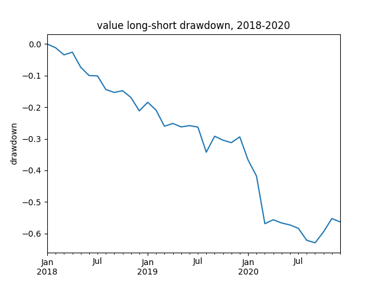
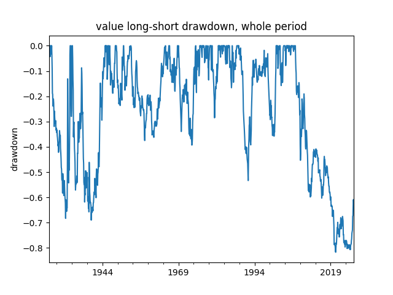

# Value factor backtest, 1926-2026

A long-short backtest of the value factor (long the cheapest, short the most expensive book-to-market decile) on 100 years of US stock data. The premium almost disappeared in the last 10 years: a Sharpe ratio of 0.04, against 0.26 in 1926-2016, and a drawdown of about 63% in 2018–2020.

Written for the course Asset Allocation and Investment Strategies (MSc Quantitative Finance, University of Warsaw), October 2026. This is my own part of a team homework.

## Data

- Source: Kenneth R. French Data Library, `Portfolios_Formed_on_BE-ME.csv` (included in this repo, version built from the 202608 CRSP database): https://mba.tuck.dartmouth.edu/pages/faculty/ken.french/ftp/Portfolios_Formed_on_BE-ME_CSV.zip
- Used: value-weighted monthly returns, July 1926 to August 2026.

## Method

- Hi 10 is the 10% of stocks with the highest book-to-market ratio (cheap stocks); Lo 10 is the 10% with the lowest (expensive stocks).
- The strategy is long Hi 10 and short Lo 10. Its monthly return is `(Hi 10 - Lo 10) / 100`.
- Metrics:
    - Annualised return: `(product of all (1 + r))^(12 / n) - 1`, where n = number of months and r = monthly return
    - Annualised volatility: `standard deviation * square root of 12`
    - Sharpe ratio: `(mean monthly return * 12) / annualised volatility` (no risk-free rate)
    - Maximum drawdown: `lowest value after a peak / peak value - 1`

## Results

```
Period                          Return       Vol    Sharpe    Max DD
whole sample                     3.09%    22.11%      0.24   -81.70%
before (1926-2016)               3.64%    22.02%      0.26   -69.00%
last 10 years (2016-2026)       -1.77%    22.95%      0.04   -67.45%
2018-2020                      -25.34%    21.54%     -1.23   -62.95%
```

The 2018-2020 drawdown restarts at zero in January 2018; the strategy was already falling before 2018.



The whole-period drawdown starts in July 1926. The strategy declined from around 2007 until 2020, then made a partial recovery.



## Did the premium survive?

The value premium weakened sharply. In the last 10 years the Sharpe ratio dropped to 0.04, from 0.26 in 1926-2016, so there is almost no return per unit of risk. In 2018-2020 the strategy fell by about 63%. From its lowest point in 2020 (around -82%) the drawdown has narrowed to about -61%, which means the strategy roughly doubled from its bottom, `(1 - 0.61) / (1 - 0.82) ≈ 2`, but it is still far below its 2007 peak. One possible reason is crowding: value has been widely traded since Fama and French's 1992 paper.

## How to run

```bash
git clone https://github.com/konradaugustyn/value-factor-backtest.git
cd value-factor-backtest
pip install -r requirements.txt
python value_factor_backtest.py
```

It prints the table above and saves the two drawdown charts.

## Limitations

- Stocks are sorted once a year, in June.
- No transaction costs and no borrowing costs for the short side.
- No risk-free rate in the Sharpe ratio.
